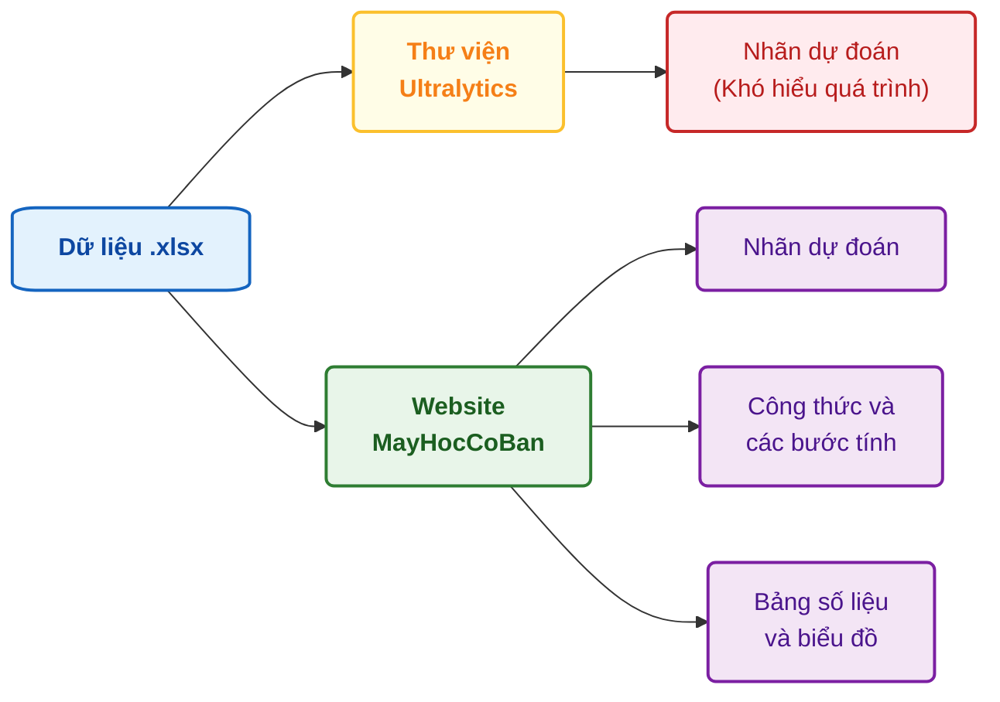
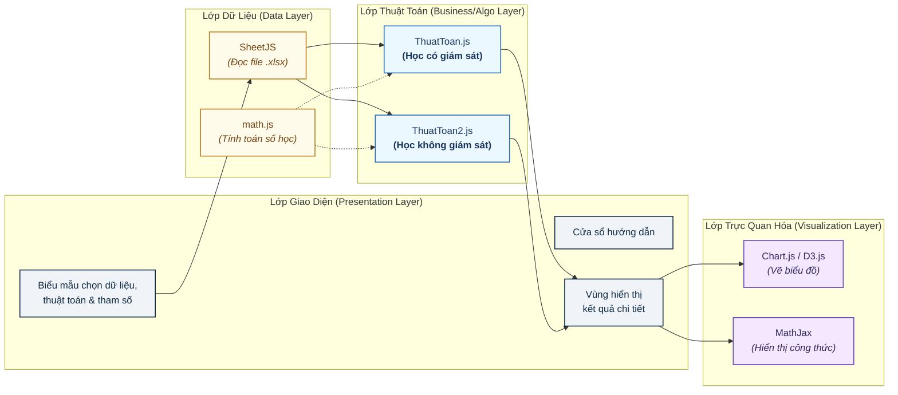
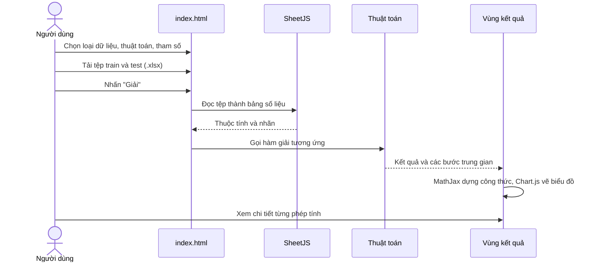
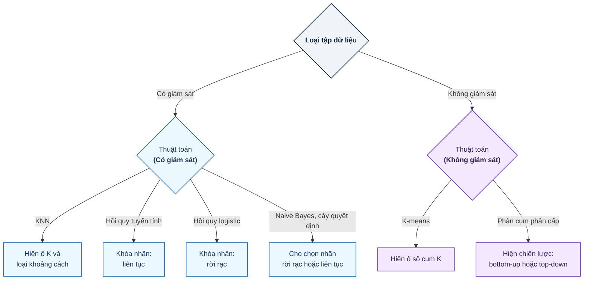
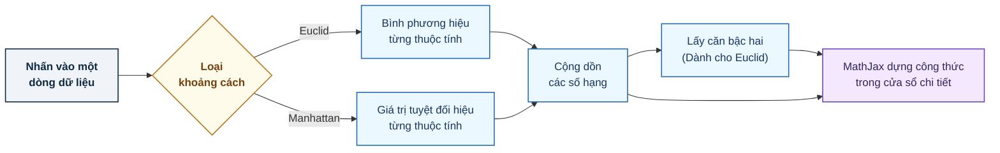

    
## Hệ thống web trực quan hóa quá trình học và dự đoán của các thuật toán máy học cơ bản

**Link website** - [huynhthanhphong231004it.github.io/Website_MayHocCoBan](https://huynhthanhphong231004it.github.io/Website_MayHocCoBan/)

---

    
&nbsp;&nbsp;&nbsp;&nbsp;&nbsp;&nbsp;&nbsp;&nbsp;&nbsp;&nbsp;&nbsp;&nbsp;&nbsp;&nbsp;&nbsp;&nbsp;&nbsp;&nbsp;
**Facbook**: https://www.facebook.com/huynh.thanh.phong.561667  

&nbsp;&nbsp;&nbsp;&nbsp;&nbsp;&nbsp;&nbsp;&nbsp;&nbsp;&nbsp;&nbsp;&nbsp;&nbsp;&nbsp;&nbsp;&nbsp;&nbsp;&nbsp;
**Tiktok**: https://www.tiktok.com/@reorioll  

&nbsp;&nbsp;&nbsp;&nbsp;&nbsp;&nbsp;&nbsp;&nbsp;&nbsp;&nbsp;&nbsp;&nbsp;&nbsp;&nbsp;&nbsp;&nbsp;&nbsp;&nbsp;
**Youtobe**: https://www.youtube.com/@ReoRioll-2304CICTCTU  

 

---

> **Tóm tắt.** Chúng tôi xây dựng một ứng dụng web chạy hoàn toàn trên trình duyệt để người học thực hành các thuật toán máy học cơ bản trên dữ liệu của chính mình. Điểm khác với các công cụ sẵn có là hệ thống không chỉ trả về nhãn dự đoán mà còn trình bày các bước tính toán, công thức và biểu đồ đi kèm. Hệ thống gồm hai nhóm bài toán: học có giám sát (KNN, Naive Bayes, cây quyết định, hồi quy tuyến tính, hồi quy logistic) và học không giám sát (K-means, phân cụm phân cấp).
>
> **Từ khóa:** máy học cơ bản, phân loại, hồi quy, phân cụm, trực quan hóa, ứng dụng web giáo dục.

---

## 1. Tổng quan

Khi học máy học, chúng tôi nhận thấy giáo trình trình bày công thức rất chặt chẽ nhưng khó hình dung, còn các thư viện như scikit-learn [10] hay bộ công cụ như WEKA [12] cho kết quả chỉ sau vài dòng lệnh, và chính những bước trung gian mà người học cần nhìn thấy lại bị ẩn đi. Thêm vào đó, muốn chạy thử một thuật toán trên dữ liệu riêng thì phải cài môi trường và viết mã đọc dữ liệu, một rào cản không nhỏ với người mới.

Nghiên cứu này đặt ra câu hỏi: có thể xây dựng một công cụ chạy ngay trên trình duyệt, nhận dữ liệu Excel quen thuộc, và đồng thời cho người học thấy được quá trình tính toán phía sau mỗi kết quả hay không?

  <i>Hình I. Khoảng trống mà hệ thống hướng tới: giữ lại quá trình tính toán bên cạnh kết quả.</i>

---

## 2. Phương pháp

### 2.1. Hướng tiếp cận

Chúng tôi chọn xây dựng ứng dụng web tĩnh, xử lý hoàn toàn phía máy khách. Lựa chọn này cho phép triển khai bằng GitHub Pages, không cần máy chủ, và dữ liệu của người dùng không bao giờ rời khỏi trình duyệt. Mọi thuật toán được đặt vào cùng một khuôn thao tác (chọn dữ liệu, chọn thuật toán, đặt tham số, bấm chạy, đọc kết quả) để người học có thể so sánh các phương pháp mà không phải làm quen lại giao diện.

### 2.2. Kiến trúc

Hệ thống chia làm bốn lớp, mỗi lớp phụ trách một việc, thể hiện ở Hình 2.

  <i>Hình II. Kiến trúc bốn lớp của hệ thống</i>

### 2.3. Luồng xử lý

Một lượt chạy đi qua các bước ở Hình 3. Người dùng chọn cấu hình và nạp hai tệp, hệ thống đọc tệp thành bảng số liệu rồi gọi hàm giải tương ứng với nhóm bài toán đã chọn (`runAlgorithm()` cho học có giám sát, `runAlgorithmunsuperviseddata()` cho học không giám sát). Kết quả và các bước trung gian được đẩy về vùng kết quả, nơi công thức và biểu đồ được dựng lên.

  <i>Hình III. Luồng xử lý của một lượt chạy</i>

### 2.4. Quy ước dữ liệu

Để mọi thuật toán nhận cùng một dạng đầu vào, chúng tôi thống nhất cấu trúc tệp Excel như Bảng 1. Dòng đầu luôn là tên thuộc tính; riêng tập huấn luyện có cột cuối là nhãn.

    
| | Tập huấn luyện | Tập dự đoán |
|---|---|---|
| Vai trò | Xây dựng và tối ưu mô hình | Dự đoán, kiểm tra sau huấn luyện |
| Dòng đầu | Tên thuộc tính và nhãn | Tên thuộc tính |
| Cột nhãn | Có (cột cuối) | Không |
| Tỷ lệ gợi ý | 70–80% | 20–30% |

  <i>Bảng 1. Quy ước định dạng dữ liệu có giám sát. Dữ liệu không giám sát không có cột nhãn.</i>

### 2.5. Ràng buộc cấu hình

Để tránh người dùng cấu hình sai, giao diện tự điều chỉnh theo lựa chọn (Hình 4). Hồi quy tuyến tính chỉ phù hợp nhãn liên tục và hồi quy logistic chỉ phù hợp nhãn rời rạc nên hệ thống khóa loại nhãn tương ứng; các ô tham số chỉ hiện ra khi thuật toán thực sự cần đến.

  <i>Hình IV. Cơ chế tự điều chỉnh giao diện theo lựa chọn của người dùng.</i>

### 2.6. Các thuật toán và cách chúng được đưa vào hệ thống

Chúng tôi chọn những thuật toán kinh điển, có công thức rõ ràng và cài đặt được trực tiếp bằng JavaScript: KNN [1], Naive Bayes [2], cây quyết định [3, 4], hồi quy tuyến tính [8, 9], hồi quy logistic [5], K-means [6] và phân cụm phân cấp [7]. Bảng 2 tóm tắt bài toán, tham số và nội dung được hiển thị cho từng thuật toán.

    
| Thuật toán | Bài toán | Tham số người dùng đặt |
|---|---|---|
| KNN | Phân loại, hồi quy | Số K, khoảng cách Euclid hoặc Manhattan |
| Naive Bayes | Phân loại | Không |
| Cây quyết định | Phân loại, hồi quy | Không |
| Hồi quy tuyến tính | Hồi quy | Không |
| Hồi quy logistic | Phân loại | Không |
| K-means | Phân cụm | Số cụm K |
| Phân cụm phân cấp | Phân cụm | Chiến lược bottom-up hoặc top-down |

  <i>Bảng 2. Các thuật toán trong hệ thống.</i>

### 2.7. Cách giải thích kết quả

Thay vì chỉ in ra nhãn, hệ thống cho phép người dùng truy ngược từng con số. Với KNN, nhấn vào một dòng dữ liệu sẽ mở cửa sổ trình bày phép tính khoảng cách giữa điểm kiểm tra $x'$ và điểm huấn luyện $x$, theo công thức Euclid hoặc Manhattan:

$$d_E = \sqrt{\sum_{i=1}^{n}(x_i - x'_i)^2}, \qquad d_M = \sum_{i=1}^{n}\lvert x_i - x'_i\rvert$$

Từng số hạng được thay giá trị cụ thể rồi cộng dồn thành kết quả (Hình 5). Cách làm này cho phép người học tự tính lại bằng tay để đối chiếu.

  <i>Hình V. Quy trình diễn giải phép tính khoảng cách mô phỏng cho giải thuật KNN.</i>

---

## 3. Kết luận

Đóng góp chính của nghiên cứu là một công cụ thực hành đặt bảy thuật toán của hai nhóm bài toán vào cùng một giao diện. Nhờ đó, người học đổi thuật toán hay tham số mà không phải đổi công cụ, và có thể quan sát cách các phương pháp xử lý cùng một tập dữ liệu. Đóng góp thứ hai là cách trình bày kết quả có thể truy ngược. Mỗi kết quả đi kèm công thức và các bước thay số, để người học đối chiếu với lý thuyết trong giáo trình thay vì tin vào một con số không rõ nguồn gốc. Đóng góp thứ ba là khả năng tiếp cận. Ứng dụng đọc trực tiếp tệp Excel, không cần cài đặt hay viết mã, và dữ liệu được xử lý ngay tại máy người dùng. Cùng với quy ước dữ liệu thống nhất và cơ chế tự khóa cấu hình sai, điều này giúp rút ngắn thời gian làm quen cho người mới.

Chúng tôi đã xây dựng Website_MayHocCoBan, một ứng dụng web giúp người học thực hành các thuật toán máy học cơ bản và nhìn thấy quá trình tính toán đằng sau kết quả. Hạn chế hiện tại là toàn bộ tính toán chạy trên trình duyệt nên tốc độ giảm khi dữ liệu lớn, hệ thống chưa có các thước đo đánh giá mô hình như ma trận nhầm lẫn hay kiểm định chéo, và cần kết nối Internet để tải thư viện. Hướng phát triển tiếp theo gồm bổ sung các thuật toán như máy vector hỗ trợ và rừng ngẫu nhiên, thêm các thước đo đánh giá, và chuyển phần tính toán nặng sang Web Worker để giao diện vẫn mượt với dữ liệu lớn hơn.
